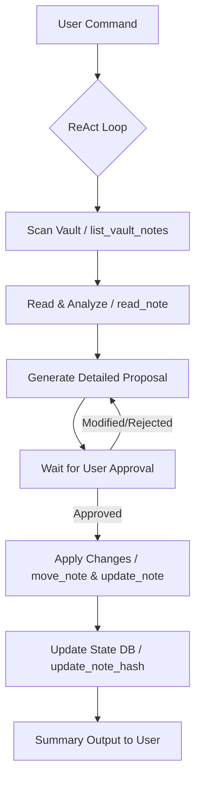
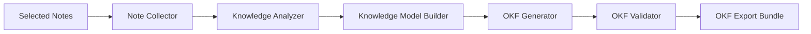

# Obsidian Organizer Agent 🗂️✨

[](https://adk.dev/)
[](https://cloud.google.com/vertex-ai/generative-ai/docs/learn/models)
[](https://www.python.org/)
[](https://github.com/astral-sh/uv)
[](https://docs.pytest.org/)

An enterprise-grade, ReAct-based AI agent designed to automatically organize scattered markdown vaults in [Obsidian](https://obsidian.md/). Powered by the **Google Agent Development Kit (ADK)** and Gemini, the agent analyzes notes, extracts concepts, establishes hierarchical folder structures, connects documents via wikilinks, tracks vault state changes via SQLite hashing, and packages notes into a standardized **Open Knowledge Format (OKF)** publication bundle.

---

## 📖 Table of Contents
1. [Problem Statement](#-problem-statement)
2. [The Solution](#-the-solution)
3. [Agent Architecture](#-agent-architecture)
4. [File & Project Structure](#-file--project-structure)
5. [Core Modules & Systems](#-core-modules--systems)
6. [Setup & Installation](#-setup--installation)
7. [Running the Agent](#-running-the-agent)
8. [Unified Testing & Evaluation Suite](#-unified-testing--evaluation-suite)
9. [Human-in-the-Loop & Safety Safeguards](#-human-in-the-loop--safety-safeguards)

---

## 🚨 Problem Statement

Personal knowledge bases, such as Obsidian vaults, suffer from "content entropy." As users create daily logs, notes, and scratchpads, organization degrades:
- **Lack of Structure**: Notes accumulate in the root directory without clean folder hierarchies.
- **Missing Metadata**: Notes lack tags or frontmatter metadata, making discovery difficult.
- **Disconnected Ideas**: Notes fail to use Obsidian's core power—wikilinks—leaving valuable conceptual connections unlinked.
- **Export/Publishing Friction**: Users lack a clean path to packaging, validating, and sharing selected notes in standard schemas (such as the Open Knowledge Format).
- **Risk of Silent Corruption**: Traditional automation tools risk silently overwriting, deleting, or corrupting user files without explicit human approval.

---

## 💡 The Solution

The **Obsidian Organizer Agent** acts as an expert local librarian. Running locally via ADK and executing tools through a secure, sandbox-aware environment:
1. **Scans** the active vault to discover all notes.
2. **Tracks state changes** dynamically by storing SHA-256 content hashes in a SQLite database to prevent redundant re-processing.
3. **Analyzes content** statically and through Gemini to group related thoughts, resolve connections, and detect duplicate or missing concepts.
4. **Formulates a detailed proposal** mapping out exactly what folders will be created, where notes will move, and how content will be updated.
5. **Enforces human approval** before modifying any local files.
6. **Executes changes securely** using relative path resolution and directory traversal guards.
7. **Publishes bundles** to standardized OKF folders with plan-then-execute pipelines and automated schemas/manifest validators.

---

## 🏗️ Agent Architecture

The agent is built using the Google ADK, implementing a **Reasoning and Action (ReAct)** loop. The architecture is split into three main components: **Agent Logic**, **Observation Tools**, and the **Publishing Pipeline**.

### 1. Unified Agent Loop


### 2. Publishing Pipeline
The Publishing Pipeline takes selected notes and compiles them into a verified Open Knowledge Format (OKF) distribution bundle.



---

## 📂 File & Project Structure

The codebase is organized cleanly for readability and ease of extension:

```
obsidian-organizer/
├── app/
│   ├── agent.py               # Main ReAct agent definition & rate-limiting plugin
│   ├── config.py              # Environment configuration & detector (Vertex vs Studio)
│   ├── tools.py               # Obsidian interaction tools (read, write, move, hash)
│   ├── app_utils/
│   │   └── paths.py           # Path resolution & directory traversal safety helpers
│   └── publisher/             # Publishing Pipeline modules
│       ├── collector.py       # Note Collector stage
│       ├── analyzer.py        # Static Knowledge Analyzer (links, scratch pads, concepts)
│       ├── builder.py         # Knowledge Model Builder
│       ├── pipeline.py        # Orchestrates Plan & Execute steps of publishing
│       ├── plan.py            # Plan dataclass representation
│       └── targets/           # Export Targets
│           └── okf/           # Open Knowledge Format export & validator
├── tests/                     # Validation Suite
│   ├── unit/                  # Pytest unit tests (collectors, builders, tools, etc.)
│   ├── integration/           # Pytest integration tests (agent stream, e2e server)
│   └── eval/                  # Layered Evaluations
│       ├── datasets/          # OKF Evaluation datasets
│       ├── eval_config.yaml   # YAML criteria for custom LLM metrics
│       ├── layered_evaluator.py # Verify tool execution sequence & contract invariants
│       └── run_eval.py        # Custom eval runner (deterministic Python + LLM qualitative checks)
├── run_tests.py               # Sequentially runs Unit, Integration, & Evals in one go
├── pyproject.toml             # Project dependencies (managed by uv)
├── agents-cli-manifest.yaml   # Google Agent CLI configuration
└── README.md                  # Project Documentation
```

---

## 🔌 Core Modules & Systems

### 1. RateLimiterPlugin (in `app/agent.py`)
To prevent exceeding Google GenAI API rate limits, a custom ADK plugin implementing the **Token Bucket** algorithm is integrated:
- Enforces requests-per-minute (RPM) limits (defaults to 15 RPM).
- Intercepts requests in `before_model_callback` and dynamically sleeps the execution thread until tokens refill.

### 2. State-Tracking Database (in `app/tools.py`)
To prevent expensive model calls on unchanged files:
- Computes SHA-256 hashes of note contents.
- Stores state in a vault-specific SQLite database located in `obsidian-agent/state/<vault_id>.sqlite`.
- Custom tools like `check_vault_changes` and `check_note_status` read this database to return list of `new`, `changed`, or `deleted` notes.

### 3. Traversal Protection (in `app/app_utils/paths.py`)
Security is paramount when an agent executes filesystem operations. All paths pass through a `safe_resolve` utility that checks that files are relative to the vault root:
```python
def safe_resolve(relative_path: str, tool_context: ToolContext | None = None) -> Path:
    vault_path = get_vault_path(tool_context)
    resolved_path = (vault_path / relative_path).resolve()
    if not resolved_path.is_relative_to(vault_path):
        raise ValueError(f"Path traversal detected: {relative_path} is outside of vault {vault_path}")
    return resolved_path
```

---

## ⚙️ Setup & Installation

### Prerequisites
1. **Python Package Manager (`uv`)**: We use `uv` for package management.
   - Install `uv`: `curl -LsSf https://astral.sh/uv/install.sh | sh` (or visit [docs](https://docs.astral.sh/uv/getting-started/installation/))
2. **Google Agents CLI**:
   - Install globally: `uv tool install google-agents-cli`

### Installation Steps
1. **Clone the repository**:
   ```bash
   git clone <GITHUB_REPO_URL>
   cd obsidian-organizer
   ```

2. **Install project dependencies**:
   ```bash
   agents-cli install
   ```
   *(This creates a `.venv` using `uv` and installs packages from `pyproject.toml`)*

3. **Configure Environment Variables**:
   Copy the example environment file and edit it to include your Gemini API key:
   ```bash
   cp .env.example .env
   # Edit .env to add your actual GOOGLE_API_KEY
   ```

4. **Configure Vault Paths**:
   Copy the example configuration file and edit the paths to point to your Obsidian vault:
   ```bash
   cp config.json.example config.json
   # Edit config.json with your desired local directory paths
   ```

---

## 🚀 Running the Agent

### Local Web Playground
Interact with the agent in a beautiful web-based chat interface:
```bash
agents-cli playground
```
This will launch a local server (typically at `http://127.0.0.1:8080`) where you can chat, view the vault structure, and approve modification plans.

### CLI Single Execution
Run a quick smoke test or command against the agent:
```bash
agents-cli run "List the notes in my vault"
```

---

## 🧪 Unified Testing & Evaluation Suite

We implement a three-layered validation strategy to ensure both code correctness and agent behavior reliability.

```
+-------------------------------------------------------------------+
|                       Unified Test Runner                         |
|                           run_tests.py                            |
+---------------------------------+---------------------------------+
                                  |
         +------------------------+------------------------+
         |                        |                        |
+--------v-------+       +--------v-------+       +--------v-------+
|   Unit Tests   |       |  Integration   |       |  Evaluations   |
|  pytest (unit) |       | pytest (integ) |       |  run_eval.py   |
+----------------+       +----------------+       +----------------+
```

### 1. Run Everything in One Go
Run the unified test runner to execute the unit tests, integration tests, and the evaluation suite sequentially:
```bash
source .venv/bin/activate
python run_tests.py
```
This runner exits with a code of `0` only if all phases pass. If any test or evaluation fails, it fails-fast and exits with `1`.

### 2. Test Types
- **Unit Tests (`pytest tests/unit`)**: Deterministically tests individual helper functions, classifiers, and tool logic (e.g. collector, builder, planner, path validation).
- **Integration Tests (`pytest tests/integration`)**: Verifies e2e integration including runner streaming, server SSE endpoints, and mock patching.
- **Evaluation Suite (`python tests/eval/run_eval.py`)**: Runs the agent in-memory against scenarios loaded from `okf-dataset.json` and evaluates the agent against two layers:
  - **Layer 1 (Contract Checks)**: Asserts tool selection rules, workflow constraints (e.g., plan happens before execute), and vault modification rules.
  - **Layer 2 (LLM Behavioral Grading)**: Uses an LLM judge to score intent understanding, planning, safety, and hallucinations against our custom `verify_publish_workflow` metric.

---

## 🛡️ Human-in-the-Loop & Safety Safeguards

To prevent accidental vault state corruption, the agent implements these strict guardrails:
1. **Proposal Verification**: The agent generates a structured proposal (such as creating directories, renaming notes, or adding tags) and returns it to the user. It **never** applies changes without explicit approval.
2. **Deterministic Contract Evaluation**: Our Layer 1 checks verify that the agent never calls `execute` actions before the `plan` step has run.
3. **No Vault Modification Invariant**: Ensures that read-only tasks or publishing workflows do not write or modify content in the Obsidian vault.
